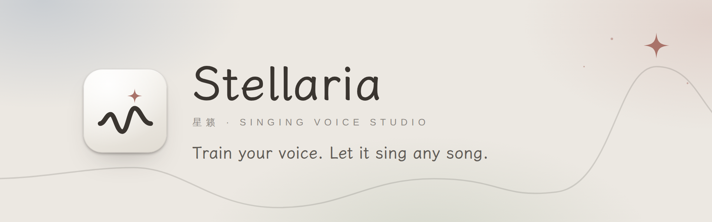

<p align="center">
  <picture>
    <source media="(prefers-color-scheme: dark)" srcset="docs/images/banner-en-dark.png">
    
  </picture>
</p>

<p align="center">
  <b>English</b>　·　<a href="README.zh-CN.md">简体中文</a>
</p>

<p align="center">
  <a href="https://github.com/SodiumHydride/Stellaria/releases"></a>
  
  <a href="LICENSE"></a>
</p>

Stellaria (星籁) is a desktop studio for singing voice conversion, built on
[DDSP-SVC](https://github.com/yxlllc/DDSP-SVC). Organise recordings, train a voice, then
convert, tune, mix and export finished songs, all without opening a terminal.

> [!IMPORTANT]
> **Stellaria is free. If you paid for it, you were scammed.** Download it only from this
> repository's [Releases](https://github.com/SodiumHydride/Stellaria/releases).

## What it does

### Material
Drop in recordings, whole songs, videos or folders. Stellaria evens out format and loudness,
removes accompaniment and reverb, slices automatically, drops clips that are too short, clipped,
silent or duplicated, and gives you a health report. Your original files are never changed.

### Training
Pick a preset for your graphics memory and start. Curves update live and every preview can be
compared with the original voice. Pausing saves first, so no progress is lost, and you can try
the latest checkpoint while training continues.

### Creating
Each song is a canvas: separate the vocals, convert them to your voice, tune them phrase by
phrase in the pitch editor, mix with the built-in effects or your own VST3 / AU plug-ins,
arrange on a multitrack timeline, and export WAV, FLAC, MP3 or stems.

### And more
- Import DDSP-SVC models trained elsewhere; pack a voice to move it to another computer.
- One-click runtime setup that picks the fastest download source. Or use a Python / conda you
  already have; Stellaria never changes it.
- Graphics memory is released when idle; light and dark themes.
- Your material, models and songs stay on your computer. Nothing is uploaded.

## Download and install

1. Get the installer from [Releases](https://github.com/SodiumHydride/Stellaria/releases):
   `.exe` for Windows, `.dmg` for macOS on Apple silicon.
2. The installers are not signed yet. On Windows, when SmartScreen warns, choose
   **More info → Run anyway**; on macOS, **right-click the app → Open**.
3. On first launch Stellaria checks your computer and sets up its runtime; just follow along.

| | Material · creating | Training |
|---|:---:|:---:|
| **Windows 10 / 11** (x64) | ✓ | NVIDIA GPU required |
| **macOS** (Apple silicon) | ✓ | Not supported; train on Windows and import the model |

## Responsible use

Use only your own voice or voices you have permission to use. When you publish something made
with Stellaria, follow the law where you live, including any rule to label it as AI-generated.
See the Terms of Use in the app.

## License

Stellaria is free to use, change and share, **but it may not be sold, and nobody may charge for
it**: no paid downloads, no paid bundles, no paid installation, training or conversion
services. The license is MIT + Commons Clause; see [`LICENSE`](LICENSE).

The DDSP-SVC engine in `engine/` is by yxlllc, under its own MIT License. Some pretrained
models the app downloads are for non-commercial use only, such as the default NSF-HiFiGAN
vocoder (OpenVPI, CC BY-NC-SA 4.0); the full list is in the app under **Settings → About** and
on the **Resources** page.

## Thanks

[DDSP-SVC](https://github.com/yxlllc/DDSP-SVC) · NSF-HiFiGAN (OpenVPI) · ContentVec · RMVPE ·
Demucs · BS / Mel-RoFormer and MSST · pedalboard · LXGW WenKai, and the other projects listed in
the app under **Settings → About**.

<details>
<summary><b>Build from source</b></summary>

<br>

Requires Node.js 22, Rust and Python 3.11.

```bash
# backend (--fake simulates training and conversion, so the UI works without a GPU)
scripts/dev-backend.sh --fake

# UI; open http://127.0.0.1:1420/?backend=http://127.0.0.1:8765&token=dev
cd desktop && npm install && npm run dev

# desktop shell; point STELLARIA_PYTHON at a Python with the dependencies to skip setup
STELLARIA_PYTHON=/path/to/python npm run tauri dev
```

Architecture: [`docs/architecture.md`](docs/architecture.md) · API: [`docs/api.md`](docs/api.md).

</details>
