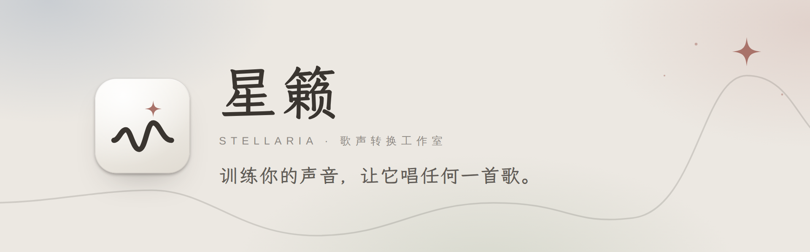

<p align="center">
  <picture>
    <source media="(prefers-color-scheme: dark)" srcset="docs/images/banner-zh-dark.png">
    
  </picture>
</p>

<p align="center">
  <a href="README.md">English</a>　·　<b>简体中文</b>
</p>

<p align="center">
  <a href="https://github.com/SodiumHydride/Stellaria/releases"></a>
  
  <a href="LICENSE"></a>
</p>

星籁是一个基于 [DDSP-SVC](https://github.com/yxlllc/DDSP-SVC) 的桌面歌声转换工作室。从整理录音、训练模型，到换声、修音、混音、导出成品，全程都在图形界面里完成，不用打开命令行。

> [!IMPORTANT]
> **星籁是免费的，花钱买到的就是被骗了。** 请只从本页的 [Releases](https://github.com/SodiumHydride/Stellaria/releases) 下载。

## 能做什么

### 整理素材
把录音、整首歌、视频或整个文件夹拖进来。星籁会统一格式和音量，去掉伴奏和混响，自动切片，筛掉太短、爆音、静音和重复的片段，再给出一份体检报告。原文件不会被改动。

### 训练
按显存选一个档位就能开始。训练曲线实时更新，每个试听点都能和原声对比。暂停会先存档，进度不丢；训练的同时也能拿最新的存档试唱。

### 创作
每首歌是一块画布：分离人声和伴奏，换成你训练的声音，在音高编辑器里逐句修音，再用内置效果器或你自己的 VST3 / AU 插件混音，排进多轨时间线，导出 WAV、FLAC、MP3 或分轨。

### 其他
- 可以导入别人训练好的 DDSP-SVC 模型；角色能打包带到另一台电脑。
- 运行环境一键安装，自动选择国内镜像或国际源。也可以直接用你已有的 Python / conda，星籁不会改动它。
- 空闲时自动释放显存；浅色、深色两套界面。
- 素材、模型和作品只保存在你自己的电脑上，不会上传。

## 下载与安装

1. 在 [Releases](https://github.com/SodiumHydride/Stellaria/releases) 下载安装包：Windows 选 `.exe`，macOS（Apple 芯片）选 `.dmg`。
2. 安装包暂时没有签名：Windows 提示"已保护你的电脑"时，点 **更多信息 → 仍要运行**；macOS 请在应用上 **右键 → 打开**。
3. 第一次打开时，星籁会检查你的电脑并装好运行环境，跟着提示走就行。

| | 整理素材 · 创作 | 训练 |
|---|:---:|:---:|
| **Windows 10 / 11**（x64） | ✓ | 需要 NVIDIA 显卡 |
| **macOS**（Apple 芯片） | ✓ | 不支持，可在 Windows 上训练后导入模型 |

## 使用须知

请只用你自己的声音，或已经取得授权的声音。发布用星籁生成的作品时，请遵守当地法律，并按规定标明为 AI 生成的内容。详见软件里的《使用条款》。

## 许可

星籁可以免费使用、修改和分享，**但不能出售，也不能拿它收费**：付费下载、付费整合包、代安装、代训练、代转换都不行。许可证为 MIT + Commons Clause，全文见 [`LICENSE`](LICENSE)。

`engine/` 中的 DDSP-SVC 引擎由 yxlllc 开发，遵循它自己的 MIT 许可证。软件运行时下载的部分预训练模型只允许非商业用途，例如默认声码器 NSF-HiFiGAN（OpenVPI，CC BY-NC-SA 4.0）；完整清单见软件的 **设置 → 关于** 和 **资源** 页面。

## 致谢

[DDSP-SVC](https://github.com/yxlllc/DDSP-SVC) · NSF-HiFiGAN（OpenVPI）· ContentVec · RMVPE · Demucs · BS / Mel-RoFormer 与 MSST · pedalboard · 霞鹜文楷，以及软件 **设置 → 关于** 中列出的其他项目。

<details>
<summary><b>从源码构建</b></summary>

<br>

需要 Node.js 22、Rust 和 Python 3.11。

```bash
# 后台服务（--fake 会模拟训练和转换，没有显卡也能开发界面）
scripts/dev-backend.sh --fake

# 界面，在浏览器中打开 http://127.0.0.1:1420/?backend=http://127.0.0.1:8765&token=dev
cd desktop && npm install && npm run dev

# 桌面外壳；STELLARIA_PYTHON 指向一个装好依赖的 Python 可跳过首次安装
STELLARIA_PYTHON=/path/to/python npm run tauri dev
```

架构见 [`docs/architecture.md`](docs/architecture.md)，接口见 [`docs/api.md`](docs/api.md)。

</details>
